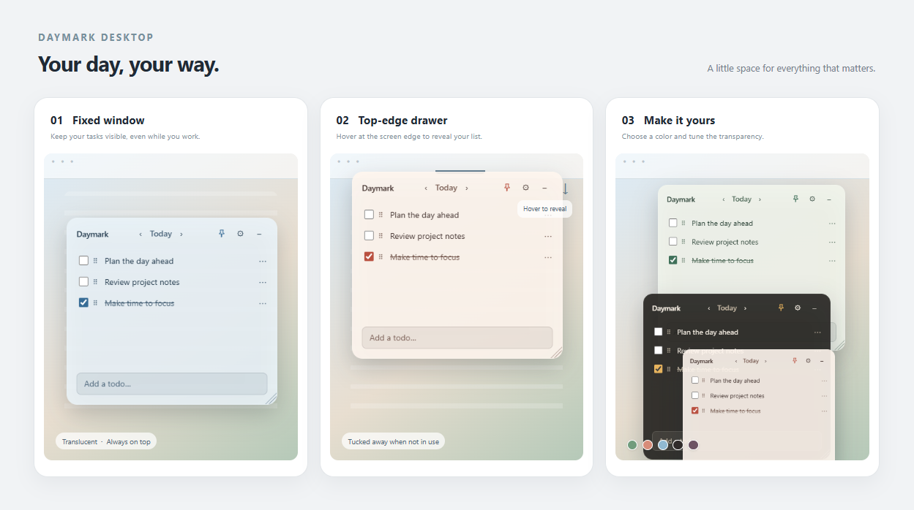

<div align="center">

**English** | [简体中文](README.zh-CN.md)




# Daymark

**A lightweight desktop to-do list that keeps what matters in sight.**

Transparent and always on top · Silent reminders · Calendar and countdowns · Local data

[](https://github.com/jensenzhong/daymark-desktop/releases/latest)
[](https://github.com/jensenzhong/daymark-desktop/releases/latest)
[](LICENSE)

[Download the latest release](https://github.com/jensenzhong/daymark-desktop/releases/latest) · [Features](#features) · [Development](#windows-development-and-preview)

</div>

---

Daymark is a lightweight desktop to-do app. Keep a translucent list above your browser, or tuck it away at the top edge of your screen and reveal it when needed. Tasks, reminders, and settings are stored on your computer; no account is required.

## Contents

- [Screenshots](#screenshots)
- [Features](#features)
- [Download and installation](#download-and-installation)
- [Getting started](#getting-started)
- [Windows development and preview](#windows-development-and-preview)
- [Checks and packaging](#checks-and-packaging)
- [Data and backups](#data-and-backups)
- [Project structure](#project-structure)
- [License](#license)

## Screenshots

The banner uses example tasks to show the fixed window, top-edge drawer, and themes. The drawer illustration shows the expanded state: move the pointer to the small handle at the top edge to reveal the list.

The translucent window can stay above a browser, with reminder countdowns visible alongside tasks:


The calendar shows a red dot on dates with tasks:


## Features

- **Daily task list:** Add, edit, complete, and delete tasks. Drag the handle to reorder them.
- **Calendar:** Open the date at the top of the window to switch between week and month views. Dots mark dates with tasks.
- **Batch entry:** Paste paragraphs separated by blank lines, or a list where each line has a number or bullet, to create separate tasks.
- **Reminders and countdowns:** Set a reminder from a task's `⋯` menu. When it is due, a silent, centered window appears above other windows until you confirm it.
- **Window and appearance:** Toggle always-on-top with the pin, resize from the lower-right corner, and adjust themes, opacity, and automatic height in Settings.
- **Top-edge drawer:** Hide the list at its current horizontal position and hover over the handle at the top edge to reveal it. Switch back to a fixed window at any time.
- **Language:** The interface defaults to English. Switch to Chinese in Settings → Language; your choice is saved locally.
- **Daily rollover:** Overdue incomplete tasks move to the current day. Completed tasks stay on their original date.

Daymark must be running for reminders and daily rollover to occur. Hiding the window keeps the app running in the system tray. If the app was closed, it processes overdue reminders and incomplete tasks when it next starts.

## Download and installation

Open the [latest release](https://github.com/jensenzhong/daymark-desktop/releases/latest) and choose an installer under Assets:

| Platform | Installer |
| --- | --- |
| Windows | `Daymark.Setup...exe` |
| Mac with Apple silicon | `.dmg` containing `arm64` in its name |
| Mac with Intel processor | `.dmg` without `arm64` in its name |

Open the downloaded installer and follow its instructions.

## Getting started

1. Launch Daymark, enter a task in the bottom field, and press Enter.
2. Click a task to edit it, use its checkbox to mark it complete, or drag the dotted handle to reorder it.
3. Select `⋯` beside a task, choose the clock icon, set a time, and confirm the reminder. Use the trash icon to delete a task.
4. Click the date at the top to choose another day, or use the arrows to move between days.
5. Open Settings to adjust the theme, opacity, language, and automatic height. Adding a task re-enables automatic height after a manual height adjustment.
6. Select `–` to hide the window. Use the Daymark icon in the Windows notification area to show it again or quit.

For the drawer, choose **Top drawer** under **Display mode** in Settings. Move the window to your preferred horizontal position. It hides when the pointer leaves, and appears when you hover over its handle at the top edge. Switching back to **Fixed window** restores that mode's position and size.

### Batch-entry example

Paste this list into the task field to create three separate tasks:

```text
1. Plan today's work
2. Check project progress with the team
3. Prepare tomorrow's meeting materials
```

You can also paste paragraphs separated by blank lines. After a reminder is set, its time and countdown appear beneath the task.

## Windows development and preview

Install Git and **Node.js 20.19+ (20.x) or 22.12+**, including npm.

```powershell
git clone https://github.com/jensenzhong/daymark-desktop.git
cd daymark-desktop
npm ci
npm run dev
```

The development window supports front-end hot updates. Restart `npm run dev` after changing the Electron main process or preload scripts.

## Checks and packaging

```powershell
npm run typecheck    # TypeScript checks
npm test             # Task storage, rollover, and reminder checks
npm run build        # Compile production code into out/
npm run build:win    # Build Windows NSIS installers into dist/
```

`build:win` is configured for x64 and ARM64. Packaging may download Electron and build tools. macOS and Linux build commands are also available in `package.json`; routine development and preview focus on Windows.

Install the development dependencies when building from source. React and Zustand are bundled into the renderer during the build, so their original packages are not shipped a second time. Installers retain English and Chinese Electron locale resources.

GitHub Actions runs builds for pushes to `main` and pull requests. Pushing a `v*` tag builds installers and publishes a GitHub Release when the workflow succeeds. Release assets include a Windows `.exe` and separate Mac `.dmg` files for Apple silicon and Intel. GitHub adds source-code downloads automatically.

Daymark does not currently update itself; download and install new releases manually.

## Data and backups

Tasks and settings are stored as JSON in Electron's user-data directory. On Windows, the default location is usually:

```text
%APPDATA%\daymark-desktop\todos.json
%APPDATA%\daymark-desktop\settings.json
```

Quit the app before backing up or restoring these files. Daymark does not require an account or provide cloud sync. The GitHub repository stores the source code; it does not automatically back up your personal tasks.

When saving, Daymark retains the previous successful version as a `.bak` file. If data cannot be read, it displays an error instead of overwriting it. Back up both the original file and its `.bak` before attempting recovery.

## Project structure

```text
src/main/          Electron windows, reminders, tray, rollover, and local storage
src/preload/       Restricted IPC interface exposed to the renderer
src/renderer/      React interface, styles, and state
src/shared/        Types and themes shared by the main and renderer processes
build/             Application icon
tests/             Task storage and reminder checks
.github/workflows/ GitHub Actions build and release workflow
```

Built with Electron, electron-vite, React, TypeScript, Tailwind CSS, and Zustand.

| File | Purpose |
| --- | --- |
| `package.json`, `package-lock.json` | Scripts, dependencies, and the lockfile used by `npm ci` |
| `electron.vite.config.ts`, `electron-builder.yml` | Development/build and installer configuration |
| `tsconfig*.json` | TypeScript configuration for the main process and renderer |
| `.gitignore`, `.gitattributes` | Ignored files and Git file handling |
| `build/icon.png` | Application, tray, and installer icon |
| `LICENSE` | Original MIT license and copyright information |

## License

Released under the MIT license. See [LICENSE](LICENSE) for the original copyright information.
