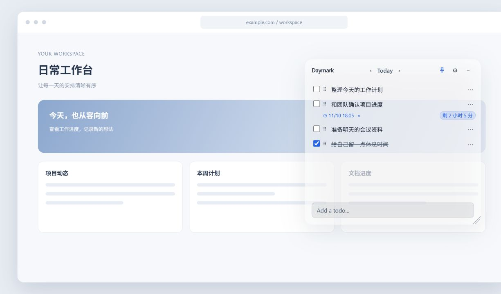
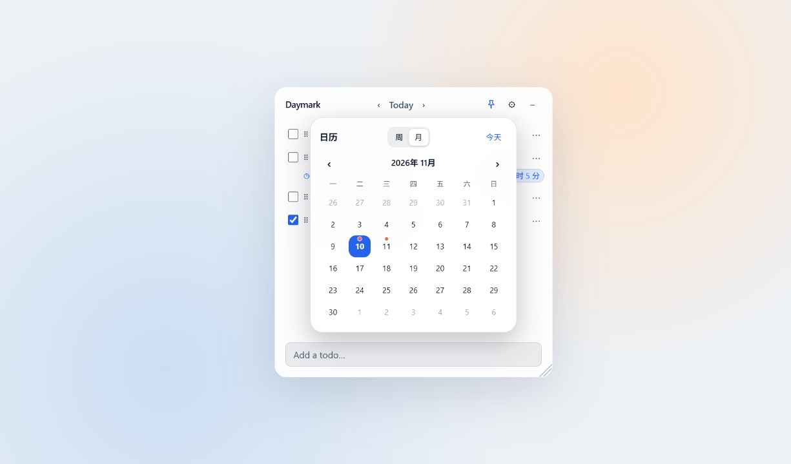

# Daymark · 桌面待办清单

Daymark 是一个轻量的桌面待办应用，主要面向 Windows。它将每日清单、无声提醒和日期日历放在一个可调整大小的桌面窗口中，数据保存在本机。

## 界面预览

以下图片使用演示任务和模拟的浏览器页面，展示半透明置顶效果、提醒倒计时和日历。可以在设置中调整窗口透明度；顶部图钉用于切换置顶。日历中的红点表示对应日期有任务。





## 主要功能

- **每日清单**：添加、编辑、勾选和删除任务，拖动任务左侧的手柄可以调整顺序。
- **日历**：点击顶部日期打开日历，切换周视图或月视图；有任务的日期显示红点。选择日期后查看或添加当天的任务。
- **批量添加**：在输入框粘贴多个空行分隔的段落，或者每行都有编号、短横线等列表标记的文本，可自动拆成多条任务。
- **提醒与倒计时**：通过任务右侧的 `⋯` 设置提醒。到点时显示居中、置顶的无声提醒窗口，确认后关闭；任务下方显示剩余时间。
- **窗口与外观**：顶部图钉可切换置顶；右下角可拖动调整窗口。设置中可切换主题、调整透明度和自动适配高度；内置 Claude Coral 珊瑚红主题。
- **顶部抽屉**：在设置中选择“顶部抽屉”，窗口会收起到它所在位置对应的屏幕顶部；将鼠标移到顶部细条即可展开。也可以随时切回固定窗口。
- **跨天处理**：未完成的过期任务会在程序运行时顺延至当天；已完成任务保留在原日期。

提醒和跨天处理需要应用正在运行。隐藏窗口后，程序仍在系统托盘运行；如果应用当时未运行，下次启动后会处理已经到期的提醒和未完成任务。

## 使用方法

1. 启动 Daymark，在底部输入框输入任务并按 Enter。
2. 点击任务文字可编辑；勾选框用于标记完成。拖住左侧的点状手柄可以重排。
3. 点击任务右侧的 `⋯`，选择时钟图标设置提醒，或选择垃圾桶图标删除任务。
4. 点击顶部日期选择任意一天，点击左右箭头切换前后日期。
5. 在设置中调整主题、透明度和自动高度。手动调整高度后，添加任务可重新启用自动高度。
6. 点击右上角 `–` 隐藏窗口；通过 Windows 通知区域的 Daymark 托盘图标显示窗口或退出程序。

如果喜欢边缘抽屉，在设置的“显示方式”中选择“顶部抽屉”。将窗口拖到希望的横向位置后，鼠标离开时它会收起；将鼠标放到该位置上方的屏幕顶部细条即可再次展开。输入任务时抽屉会保持打开。切换回“固定窗口”会恢复固定模式的位置与尺寸。

### 批量添加示例

将下面内容一次性粘贴进底部输入框，Daymark 会按编号拆成三条清单：

```text
1. 整理今天的工作计划
2. 和团队确认项目进度
3. 准备明天的会议资料
```

也可以粘贴由空行分隔的多个段落。设置提醒后，时间和倒计时会出现在对应任务下方；点击顶部日期，可以通过周视图或月视图查看其他日期的清单。

## Windows 开发与预览

需要 Git，以及 **Node.js 20.19+（20.x）或 22.12+** 和随 Node.js 安装的 npm。

```powershell
git clone https://github.com/jensenzhong/daymark-desktop.git
cd daymark-desktop
npm ci
npm run dev
```

开发窗口支持前端热更新；修改 Electron 主进程或预加载脚本后，重新运行 `npm run dev` 以确保加载最新代码。仓库当前是私有仓库时，克隆和下载需要有对应的 GitHub 访问权限。

## 检查与打包

```powershell
npm run typecheck    # TypeScript 检查
npm run build        # 编译生产代码到 out/
npm run build:win    # 构建 Windows NSIS 安装包到 dist/
```

`build:win` 配置了 x64 和 ARM64 安装包。构建可能需要下载 Electron 和打包工具。macOS 与 Linux 的打包命令保留在 `package.json` 中；本项目的日常开发和预览以 Windows 为主。

GitHub Actions 在推送 `main` 和创建拉取请求时执行构建；推送 `v*` 标签时，构建成功后会上传安装包并发布 GitHub Release。具体以工作流运行结果为准。

Release 页面提供 Windows 的 `.exe`，以及苹果芯片和 Intel 芯片各一份 Mac `.dmg`。页面中的 Source code 下载项由 GitHub 自动生成。应用目前没有内置自动更新，安装新版本需要手动下载安装包。

## 数据与备份

待办和设置使用 JSON 文件保存在 Electron 的用户数据目录。Windows 默认路径通常为：

```text
%APPDATA%\daymark-desktop\todos.json
%APPDATA%\daymark-desktop\settings.json
```

建议退出程序后再备份或恢复这两个文件。应用不需要登录，也没有内置云同步；GitHub 仓库用于管理代码，不会自动备份个人待办数据。

## 项目结构

```text
src/main/          Electron 窗口、提醒、托盘、跨天处理和本地存储
src/preload/       提供给界面的受限 IPC 接口
src/renderer/      React 界面、样式和状态管理
src/shared/        主进程与界面共用的类型和主题
build/             应用图标
.github/workflows/ GitHub Actions 构建与发布流程
```

技术栈：Electron、electron-vite、React、TypeScript、Tailwind CSS 和 Zustand。

仓库根目录中其余文件的用途：

| 文件 | 作用 |
| --- | --- |
| `package.json`、`package-lock.json` | 项目命令、依赖与锁定版本；`npm ci` 需要锁文件 |
| `electron.vite.config.ts`、`electron-builder.yml` | 分别配置开发构建和安装包打包 |
| `tsconfig*.json` | 分别检查 Electron 主进程和界面代码 |
| `.gitignore`、`.gitattributes` | 排除生成文件、统一文本和图片的 Git 处理方式 |
| `build/icon.png` | 应用、托盘及安装包使用的图标 |
| `LICENSE` | 原项目的 MIT 许可和版权信息 |

## 许可证

基于 MIT 许可证，原项目版权信息见 [LICENSE](LICENSE)。
